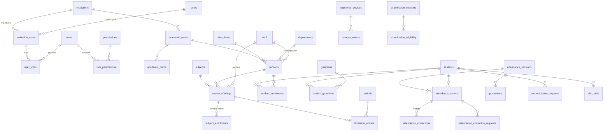

# Database schema

PostgreSQL, managed with Drizzle migrations in `apps/api/drizzle/`. Schema source: `apps/api/src/db/schema/*.ts`.

Every institution-owned table has `institution_id` (FK → `institutions`, cascade delete) and is always filtered by it.

## Entity relationships



## Tables by area

| Area | Tables |
|---|---|
| SaaS | `institutions`, `institution_branches`, `institution_settings`, `subscription_plans`, `institution_subscriptions`, `support_access_grants` |
| Identity & access | `users`, `refresh_tokens`, `password_reset_tokens`, `institution_users` (memberships), `roles`, `permissions`, `role_permissions`, `user_roles`, `audit_logs` |
| Academic | `academic_years`, `academic_terms`, `departments`, `programmes`, `class_levels`, `sections`, `subjects`, `course_offerings`, `subject_enrolments`, `student_enrolments`, `periods`, `rooms`, `timetable_entries`, `calendar_events` |
| People | `students`, `student_status_history`, `guardians`, `student_guardians`, `staff`, `staff_leave_requests` |
| Attendance | `attendance_policies`, `attendance_sessions`, `attendance_records`, `attendance_corrections`, `attendance_correction_requests`, `qr_sessions`, `qr_scan_events` |
| Leave | `leave_types`, `student_leave_requests` |
| Communication | `notifications`, `notification_delivery_logs`, `notification_preferences`, `notification_templates`, `announcements`, `announcement_reads` |
| Devices & campus | `registered_devices`, `rfid_cards`, `campus_events`, `visitor_logs` |
| Exams | `examination_sessions`, `examination_eligibility` |
| AI | `ai_usage_logs` |

## Integrity rules worth knowing

- `attendance_records` unique on `(session_id, student_id)` — no duplicate marks.
- Partial unique indexes: one live session per `(offering, date, period)`; one daily register per `(section, date)`; one current academic year per institution; one default policy per institution; one open correction request per record; one *active* card per card UID per institution.
- `campus_events` unique on `(institution_id, dedupe_key)` — device replays are idempotent.
- Deleting a year, class level, section or course offering that has attendance sessions is refused by the API (it would cascade).
- Students, staff, departments and subjects are soft-deleted (`deleted_at`).
- `students.identity_token` is an opaque random value used in ID-card QR codes (no personal data).
- `students.medical_notes` is returned only to holders of `students.medical.read`.

## Migrations

```bash
npm run db:generate -w apps/api   # after editing schema/*.ts — creates a new SQL migration
npm run db:migrate                # applies pending migrations, syncs permissions/plans
```
